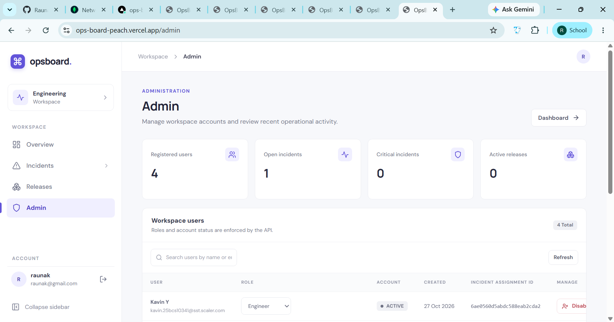
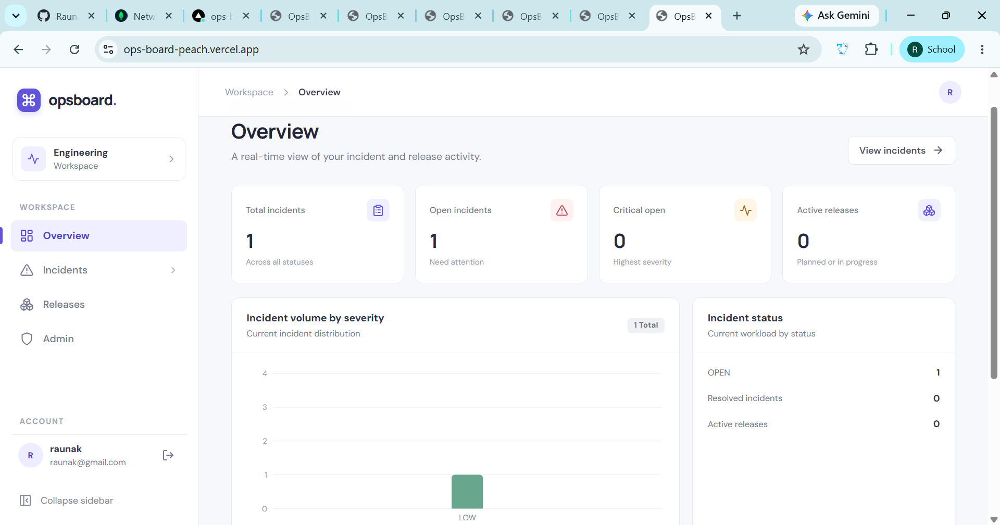
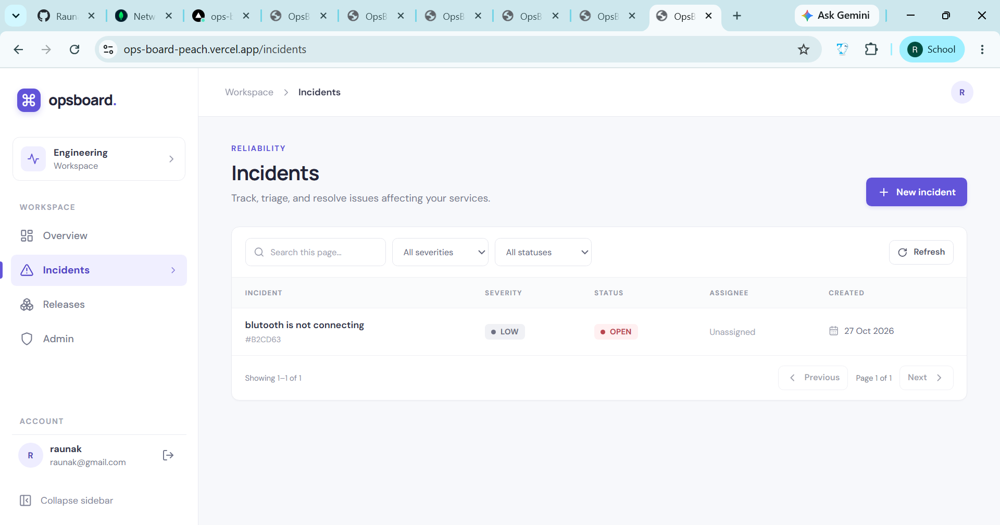
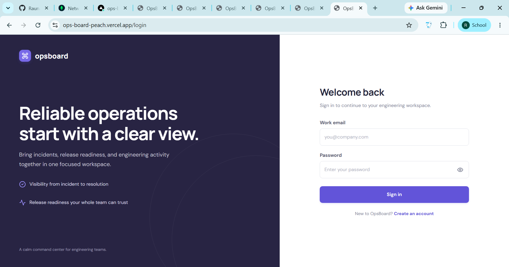

# OpsBoard — Incident & Operations Management Platform

OpsBoard is a full-stack MERN application designed to manage operational incidents, track releases, and provide role-based access to different users. It provides a centralized dashboard for monitoring and managing operational activities.

## 🚀 Live Demo

- **Frontend:** https://ops-board-peach.vercel.app
- **Backend API:** https://opsboard-6w58.onrender.com

## ✨ Features

- **Authentication:** User registration and login using JWT-based authentication.
- **Secure Sessions:** HTTP-only cookies for authentication.
- **Role-Based Access Control:** Different access levels based on user roles.
- **Dashboard:** Centralized overview of operational activities.
- **Incident Management:** Access incident-related operations and tracking.
- **Release Management:** Manage and track releases.
- **Admin Features:** Dedicated administrative functionality.
- **REST API:** Backend APIs built with Express.js.
- **Database Integration:** MongoDB with Mongoose.
- **Deployment:** Frontend deployed on Vercel and backend on Render.


## 📸 Screenshots

### Admin Panel


### Dashboard


### Incident Management


### Login Page



## 🛠️ Tech Stack

**Frontend**
- React
- Vite
- Axios
- JavaScript
- CSS

**Backend**
- Node.js
- Express.js
- MongoDB
- Mongoose
- JSON Web Tokens (JWT)
- bcrypt
- Cookie Parser
- Helmet

## 📁 Project Structure

```text
OpsBoard/
├── client/          # React frontend
│   ├── public/
│   ├── src/
│   ├── package.json
│   └── vercel.json
│
├── server/          # Express backend
│   ├── src/
│   │   ├── controllers/
│   │   ├── middleware/
│   │   ├── models/
│   │   └── routes/
│   ├── app.js
│   ├── server.js
│   └── package.json
│
└── README.md
```

## ⚙️ Run Locally

### Prerequisites

- Node.js and npm
- MongoDB database

### 1. Clone the repository

```bash
git clone https://github.com/Raunak3526/OpsBoard.git
cd OpsBoard
```

### 2. Configure the backend

Create a `.env` file inside the `server/` directory.

```env
PORT=5000
CLIENT_URL=http://localhost:5173
MONGODB_URI=your_mongodb_connection_string
JWT_SECRET=your_strong_secret_key
NODE_ENV=development
```

Use your actual environment variable names if they differ from these examples. Never commit your real `.env` file or secrets.

### 3. Install backend dependencies

```bash
cd server
npm install
```

### 4. Start the backend

```bash
npm run dev
```

If your `server/package.json` does not define a `dev` script, use the start command configured in that file.

### 5. Configure the frontend

Create `client/.env`:

```env
VITE_API_BASE_URL=http://localhost:5000
```

### 6. Install frontend dependencies

Open a second terminal:

```bash
cd client
npm install
```

### 7. Start the frontend

```bash
npm run dev
```

Open the local URL displayed by Vite, usually `http://localhost:5173`.

## 🔐 Authentication

OpsBoard uses JWT-based authentication with HTTP-only cookies. The frontend communicates with the backend API, and protected routes require valid authentication.

For production, configure the frontend origin, database connection, and JWT secret through the deployment platform's environment variables.

## 🌐 Deployment

- **Frontend:** Vercel
- **Backend:** Render
- **Database:** MongoDB

Configure production environment variables in the respective deployment dashboards. Do not expose database credentials or JWT secrets in source code.

## 🔮 Future Improvements

- Enhanced incident analytics and reporting
- Improved notifications
- Advanced filtering and search
- Additional dashboard visualizations
- Expanded automated testing

## 👨‍💻 Author

**Raunak Mishra**

GitHub: [Raunak3526](https://github.com/Raunak3526)

---

If you find this project useful, feel free to explore the repository and its features.
