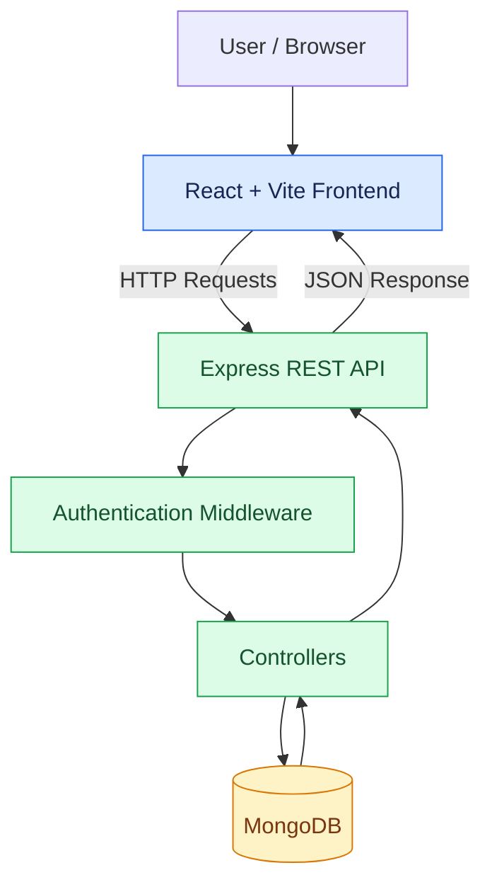

# ⚡ OpsBoard
### Incident & Release Management, Simplified.

<p align="center">
  <strong>A Full-Stack MERN Platform for Operational Visibility, Incident Tracking & Release Management.</strong>
</p>

<p align="center">
  <a href="https://ops-board-peach.vercel.app"><strong>🚀 Live Demo</strong></a>
  &nbsp; • &nbsp;
  <a href="https://drive.google.com/file/d/1wp35f2dW-rdSsdOKSnch685sc2ege1kP/view?usp=drive_link"><strong>🎬 Watch Demo</strong></a>
  &nbsp; • &nbsp;
  <a href="https://github.com/Raunak3526/OpsBoard"><strong>💻 Source Code</strong></a>
</p>

<p align="center">
  
  
  
  
</p>

---

## 🌐 Experience OpsBoard

OpsBoard is a full-stack web application built to bring incident tracking, release management, and operational visibility into one centralized interface.

Designed around a clean dashboard and authenticated user access, OpsBoard demonstrates how a modern web application can connect a responsive frontend, REST APIs, database persistence, and secure authentication into one workflow.

> **One platform. Centralized operations. Clearer visibility.**

---

## 🧭 Navigate the Project

- [✨ Key Features](#-key-features)
- [📸 Screenshots](#-screenshots)
- [🧰 Technology Stack](#-technology-stack)
- [🏗️ Architecture](#️-architecture)
- [🔐 Authentication & Security](#-authentication--security)
- [⚙️ Run Locally](#️-run-locally)
- [🚀 Deployment](#-deployment)
- [👨‍💻 Author](#-author)

---

## ✨ Key Features

| Feature | Description |
|---|---|
| 🔐 Authentication | User registration and login |
| 🍪 Secure Sessions | JWT authentication using HTTP-only cookies |
| 🛡️ Role-Based Access | Different access levels based on user roles |
| 📊 Dashboard | Centralized overview of operational activities |
| 🚨 Incident Management | Interface for incident-related tracking and operations |
| 📦 Release Management | Features for managing and tracking releases |
| ⚙️ Admin Panel | Dedicated administrative functionality |
| 🔌 REST API | Backend endpoints powered by Express.js |
| 🗄️ Database Integration | MongoDB persistence using Mongoose |
| ☁️ Cloud Deployment | Frontend on Vercel and backend on Render |

---

## 📸 Screenshots

### 🔑 Login Page

The entry point for authenticated access to OpsBoard.


### 📊 Operational Dashboard

A centralized view of the application's operational information.


### 🚨 Incident Management

Explore the incident management interface.


### 🛠️ Admin Panel

The administrative interface for authorized users.


---

## 🎬 Project Walkthrough

Want to see OpsBoard in action?

<p align="center">
  <a href="https://drive.google.com/file/d/1wp35f2dW-rdSsdOKSnch685sc2ege1kP/view?usp=drive_link">
    
  </a>
</p>

The video demonstrates the application's interface, dashboard, incident management, and administrative panel.

---

## 🧰 Technology Stack

### Frontend
<p>
  
  
  
  
  
</p>

### Backend & Database
<p>
  
  
  
  
</p>

### Authentication & Security
- JSON Web Tokens (JWT)
- HTTP-only authentication cookies
- bcrypt for password hashing
- Helmet for HTTP security headers

### Deployment
- **Frontend:** Vercel
- **Backend:** Render
- **Database:** MongoDB

---

## 🏗️ Architecture

OpsBoard follows a client-server architecture.



### Request Flow

1. A user interacts with the React frontend.
2. The frontend sends requests to the Express backend.
3. Authentication middleware protects applicable routes.
4. Controllers process requests and interact with MongoDB through Mongoose.
5. The backend returns responses to the frontend.

---

## 🔐 Authentication & Security

OpsBoard uses JWT-based authentication with HTTP-only cookies.

- **Authentication:** Registration and login workflows.
- **Cookie-based sessions:** Tokens are stored in HTTP-only cookies rather than being directly accessible to client-side JavaScript.
- **Protected routes:** Applicable endpoints require valid authentication.
- **Password protection:** bcrypt is used for password hashing.
- **HTTP security headers:** Helmet is included in the backend stack.

**Security note:** Production credentials and secrets should be configured through environment variables and must never be committed to the repository.

---

## 📁 Project Structure

```text
OpsBoard/
├── client/
│   ├── public/
│   ├── src/
│   ├── package.json
│   └── vercel.json
│
├── server/
│   ├── src/
│   │   ├── controllers/
│   │   ├── middleware/
│   │   ├── models/
│   │   └── routes/
│   ├── app.js
│   ├── server.js
│   └── package.json
│
├── Screenshots/
│   ├── admin.png
│   ├── dashboard.png
│   ├── incident.png
│   └── login.png
│
├── README.md
└── .gitignore
```

---

## ⚙️ Run Locally

### Prerequisites

- Node.js and npm
- A MongoDB database or MongoDB connection string
- Git

### 1. Clone the repository

```bash
git clone https://github.com/Raunak3526/OpsBoard.git
cd OpsBoard
```

### 2. Configure the backend

```bash
cd server
npm install
```

Create a `.env` file inside `server/` using the environment variable names expected by your backend configuration.

Example:

```env
PORT=5000
CLIENT_URL=http://localhost:5173
MONGODB_URI=your_mongodb_connection_string
JWT_SECRET=your_strong_secret_key
NODE_ENV=development
```

Use your actual backend configuration if the variable names differ. Never commit real credentials.

### 3. Start the backend

```bash
npm run dev
```

Use the start script defined in `server/package.json` if it differs.

### 4. Configure and start the frontend

Open a second terminal:

```bash
cd client
npm install
```

Create `client/.env` with the API URL expected by the frontend:

```env
VITE_API_BASE_URL=http://localhost:5000
```

Then start the frontend:

```bash
npm run dev
```

Open the local URL shown by Vite, usually `http://localhost:5173`.

<details>
<summary><strong>🧩 Troubleshooting tips</strong></summary>

- **Backend connection issues:** Check that the backend is running and the frontend API URL is correct.
- **Database connection errors:** Verify your MongoDB URI and database access.
- **Authentication issues:** Check cookie settings, frontend origin, and backend CORS configuration.
- **Environment variables:** Restart the relevant development server after changing environment files.

</details>

---

## 🚀 Deployment

| Component | Platform |
|---|---|
| Frontend | [Vercel](https://vercel.com/) |
| Backend | [Render](https://render.com/) |
| Database | MongoDB |

### Live Links

- **Live Application:** [ops-board-peach.vercel.app](https://ops-board-peach.vercel.app)
- **Backend API:** [opsboard-6w58.onrender.com](https://opsboard-6w58.onrender.com)
- **Source Code:** [GitHub Repository](https://github.com/Raunak3526/OpsBoard)

---

## 🔮 Future Improvements

- Enhanced incident analytics and reporting
- Improved notification workflows
- Advanced incident filtering and search
- Additional dashboard visualizations
- Expanded automated testing

---

## 👨‍💻 Author

### Raunak Mishra

Full-stack development project built with the MERN stack.

<p>
  <a href="https://github.com/Raunak3526">
    
  </a>
  <a href="https://github.com/Raunak3526/OpsBoard">
    
  </a>
</p>

---

<p align="center">
  <strong>OpsBoard — Bringing operational workflows into one place.</strong>
  <br/>
  Built with the MERN stack.
</p>